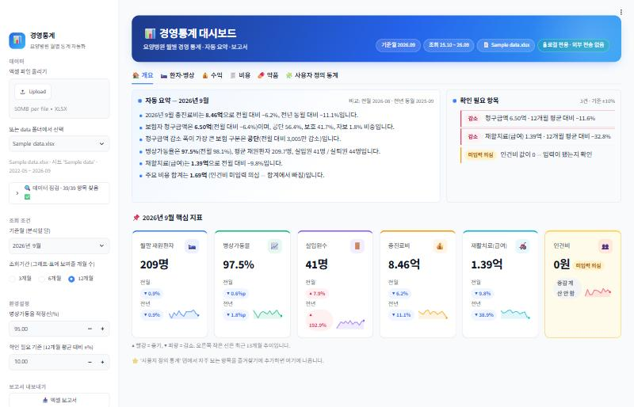
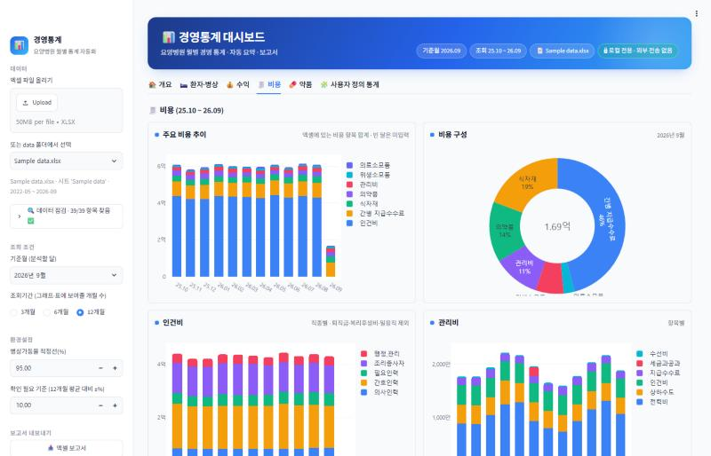
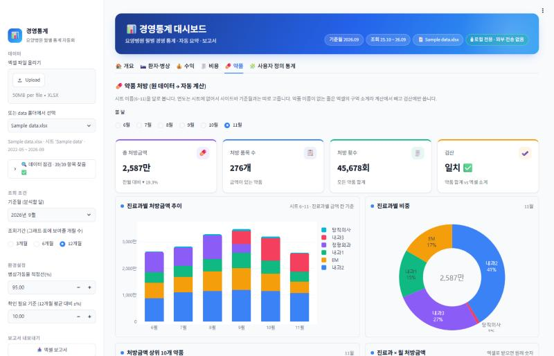
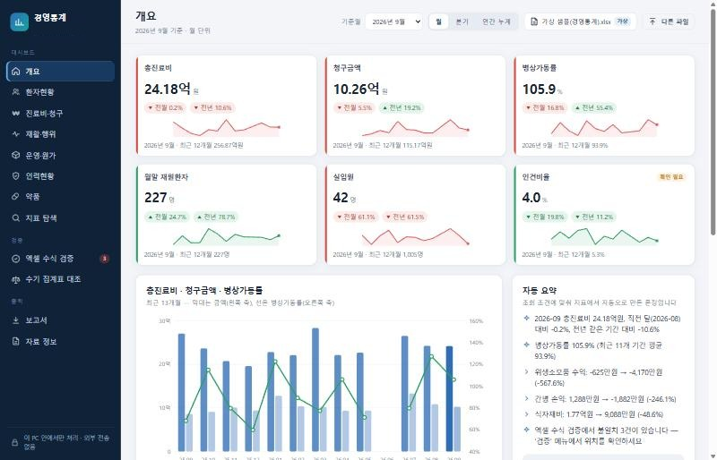
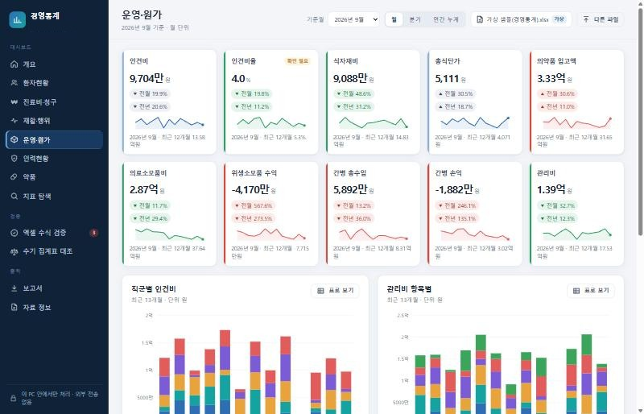
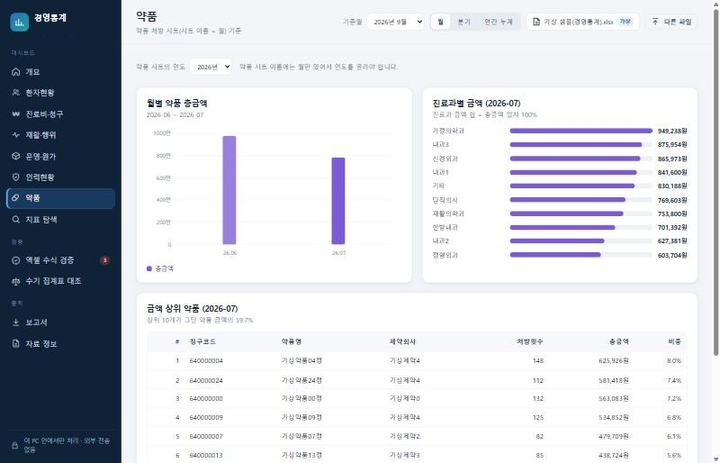
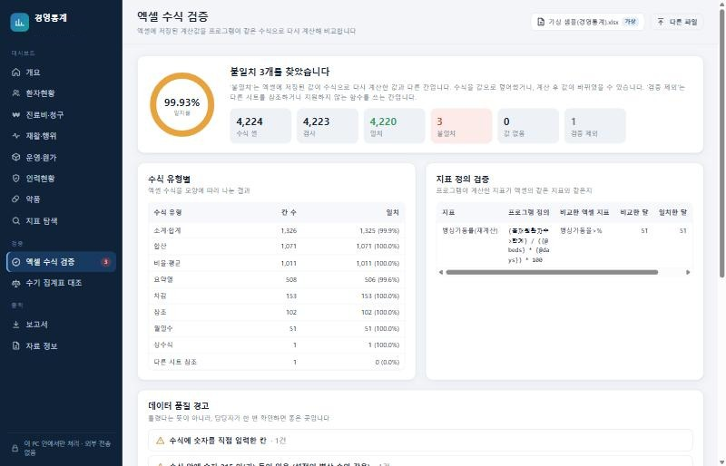
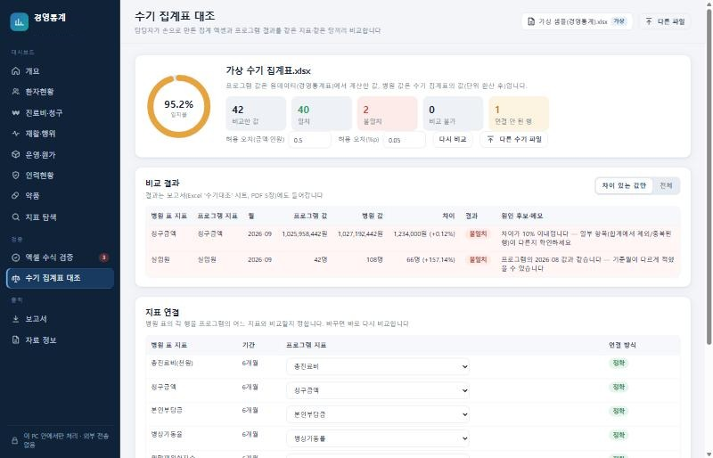

# 경영통계 대시보드 A·B안 비교 자료

2026-11-17 작성 · 병원 전달용 (원본: claude.ai 문서)

## 자료 목적

저희 팀이 같은 과제를 두 가지 방식(A안, B안)으로 만들었습니다. 두 버전을 보시고 **필요한 화면과 기능을 골라 주시면**, 고르신 내용으로 하나의 프로그램으로 합치겠습니다.

- 두 버전 모두 **병원 PC 안에서만** 동작하며, 인터넷으로 데이터를 보내지 않습니다.
- 이 자료의 화면은 모두 **가상 데이터**로 만든 것입니다. 실제 병원 값은 들어 있지 않습니다.
- 아래 질문 5개에 답해 주시면 됩니다. 10분 정도 걸립니다.

## 두 버전 한눈에

A안은 **보기 쉽고 고치기 쉬운 화면**에, B안은 **숫자 검증과 보안**에 더 힘을 실었습니다.

| 구분 | A안 | B안 |
| --- | --- | --- |
| 화면 방식 | 탭 6개 (개요·환자·병상·수익·비용·약품·사용자 정의) | 왼쪽 메뉴 + 카드형 화면 (개요·그룹 5개·약품·지표 탐색) |
| 강점 | 비용 손익, 미입력(0원) 자동 탐지, 즐겨찾기 | 엑셀 수식 재계산 검증, 수기 집계표 대조, 분기·연간 누계 |
| 보고서 | 엑셀 + 인쇄용(PDF로 저장) | 엑셀 + PDF(차트 포함) |
| 설치 | `설치.bat` 더블클릭 → `실행.bat` | `실행.bat` 더블클릭 (처음에 자동 설치) |
| 공통 | Python 3.12 필요, 처음 설치 때 인터넷 1회 필요, 이후 PC 안에서만 동작 | Python 3.11 또는 3.12 필요, 나머지는 A안과 동일 |

## 화면 비교

A안 3장, B안 5장입니다. A안은 병원 양식의 가상 데이터, B안은 프로그램이 만든 무작위 가상 샘플이라 숫자는 서로 다르고 의미가 없습니다. 화면 구성만 비교해 주세요. 캡처에 보이던 기관 이름은 가렸습니다.

### A안 · 개요

맨 위 자동 요약과 확인 필요 항목, 아래 핵심 지표 6개(전월·전년 대비, 13개월 추이). 인건비처럼 0으로 입력된 항목은 노란색 '미입력 의심'으로 표시됩니다.

### A안 · 비용

주요 비용 추이와 구성, 인건비·관리비 항목별 추이. 아래쪽에 간병·위생소모품 손익 그래프가 이어집니다.

### A안 · 약품

약품 처방 원 데이터(시트 6~11)에서 진료과별 처방금액을 자동 계산하고, 엑셀 소계와 일치하는지 검산합니다.

### B안 화면

왼쪽 메뉴로 화면을 옮기며, 위쪽에서 월 · 분기 · 연간 누계를 바꿀 수 있습니다.

### B안 · 개요

핵심 지표 6개(전월·전년 대비), 총진료비·청구금액·병상가동률 13개월 추이, 오른쪽 자동 요약.

### B안 · 운영·원가

인건비·식재료비·간병 손익·위생소모품 수익 등 비용 지표 10개를 카드로, 아래에 직군별 인건비·관리비 항목별 추이.

### B안 · 약품

월별 약품 총금액, 진료과별 금액(진료과 합 = 총금액 일치율 표시), 금액 상위 약품 표.

### B안 · 엑셀 수식 검증

엑셀에 저장된 계산값을 프로그램이 같은 수식으로 다시 계산해 비교합니다. 가상 샘플에 일부러 넣은 틀린 칸을 찾아냅니다.

### B안 · 수기 집계표 대조

담당자가 손으로 만든 집계 엑셀을 올리면 자동 계산 결과와 같은 지표·같은 달끼리 비교하고, 차이가 나면 원인 후보를 보여줍니다.

## 기능 비교표

회의에서 말씀하신 요구사항은 두 버전 모두 대부분 담았고, 차이는 아래 △·— 표시 항목입니다. (○ 있음, △ 일부, — 없음)

| 기능 | A안 | B안 |
| --- | --- | --- |
| 엑셀 하나 올리면 대시보드 | ○ | ○ |
| 자동 요약 (화면 맨 위) | ○ | ○ |
| 전월·전년 동월 대비 | ○ | ○ |
| 분기·연간 누계 | — (월별만, 3·6·12개월 추이) | ○ |
| 적정선·확인 필요 항목 표시 | ○ (화면에서 기준 변경) | ○ (지표별 목표치) |
| 비용 손익 그래프 (간병·위생소모품) | ○ | ○ (손익 카드 · 추이선) |
| 미입력(0원) 의심 자동 표시 | ○ (당월 기준) | △ (모든 달이 0인 항목) |
| 약품 처방 원 데이터 → 진료과별 통계 | ○ (+ 엑셀 소계와 검산) | ○ |
| 항목 골라 비교 · 즐겨찾기 | ○ | △ (지표 탐색, 즐겨찾기 없음) |
| 엑셀 수식 재계산 검증 | — | ○ (수식 4,500여 개 대조) |
| 수기 집계표와 자동 계산 대조 | — | ○ |
| 개인정보 시트 자동 차단 · 이름 가명 처리 | △ (가명 처리만) | ○ |
| 보고서 내보내기 | ○ 엑셀 · 인쇄용 | ○ 엑셀 · PDF |
| 심사청구 통계 (청구건수·삭감률) | — | — |

심사청구 통계는 두 버전 모두 아직 없습니다. 심평원·공단 엑셀의 **열 이름(맨 윗줄)**만 받으면 추가할 수 있습니다.

## 병원께 여쭤볼 질문

아래 5가지에 답해 주시면 그 내용대로 하나로 합칩니다.

| 번호 | 질문 | 답변 |
| --- | --- | --- |
| 1 | 화면은 A안과 B안 중 어느 쪽이 보기 편하신가요? 두 화면에서 각각 좋은 점이 있다면 알려 주세요. |  |
| 2 | **손으로 만든 집계표와 자동 계산 결과를 맞춰 보는 기능**(B안)이 필요하신가요? |  |
| 3 | **비용 손익 그래프**(간병 수입 대비 수수료, 위생소모품 매출 대비 매입)가 필요하신가요? |  |
| 4 | 통계는 월별로만 보시나요, **분기·연간 누계**도 보시나요? |  |
| 5 | 보고서는 엑셀과 PDF 중 무엇을 주로 쓰시나요? 병원에서 쓰는 보고서 양식이 따로 있나요? |  |

추가로, 심사청구 통계를 위해 심평원 심사결과·공단 지급내역·청구관리대장 엑셀의 **맨 윗줄(열 이름)만** 보내 주실 수 있는지도 여쭙니다. 데이터 내용은 필요 없습니다.

## 다음 단계

답변을 받으면 11월 안에 하나로 합치고, 12월 초에 병원 PC에서 함께 확인하겠습니다.

1. 병원 답변 받기 (가능하면 11월 24일까지)
2. 고르신 화면·기능으로 통합 버전 만들기 (11월 30일까지)
3. 병원 PC에 설치해 실제 파일로 확인 (12월 초, 방문 또는 원격 안내)

방문해서 30분 동안 두 버전을 직접 보여 드릴 수도 있습니다. 편하신 시간을 알려 주세요.
